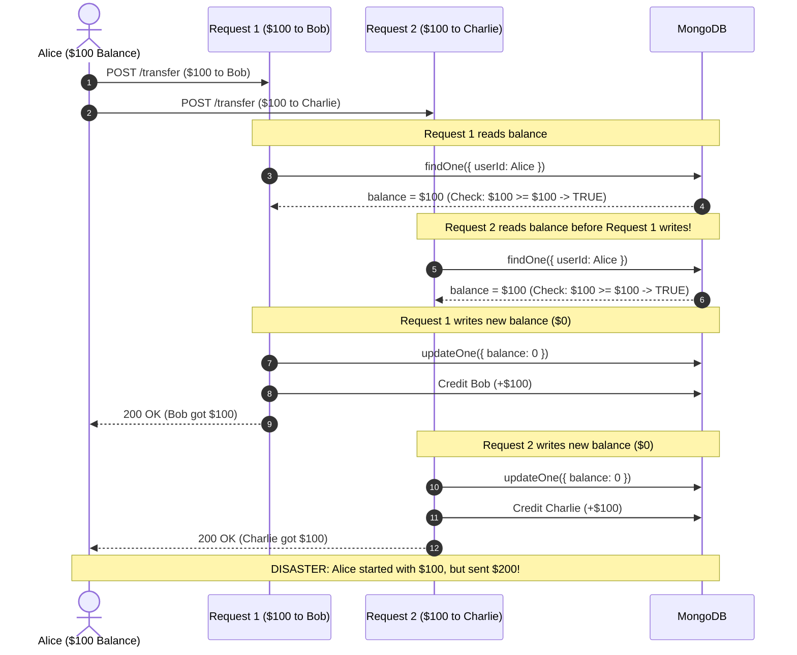

# Concurrency, Race Conditions & Double-Spending Prevention

> **Job Description Alignment:**  
> *"Strong focus on distributed back-end system design... hands-on coding experience and practical knowledge of the MERN stack."*

---

## 1. The 30-Second Interview Pitch

> *"Double-spending is the classic race condition in financial software: a user with a balance of \$100 issues two concurrent requests of \$100 at the exact same millisecond. If both requests read the balance before either writes, both observe \$100 available, both deduct \$100, and the balance illegally drops to -\$100.
> 
> In BrokeTM, we prevent double-spending through a multi-layered defense:
> 1. **MongoDB Multi-Document Transactions:** Ensures isolation and detects concurrent write conflicts.
> 2. **Atomic In-Database Math (`$inc`):** Never compute balances in Node.js memory. The database engine modifies the integer directly on disk.
> 3. **Conditional Filter Guards:** We include `{ balance: { $gte: amount } }` directly in the update query. If a concurrent transaction already drained the balance, the query matches 0 documents and fails immediately.
> 4. **Idempotency Keys:** Every client request sends a unique UUID to prevent double-charging caused by network retries or frantic button clicks."*

---

## 2. Anatomy of a Double-Spending Bug

### The Naive Implementation (Broken)
```javascript
// ❌ BROKEN: Vulnerable to Time-of-Check to Time-of-Use (TOCTOU) race condition!
router.post('/transfer-buggy', async (req, res) => {
    const { amount, to } = req.body;
    
    // Step 1: Read balance into Node.js memory
    const sender = await Account.findOne({ userId: req.userId });
    
    // Step 2: Check balance in JavaScript
    if (sender.balance < amount) {
        return res.status(400).json({ error: 'Insufficient funds' });
    }

    // <-- RACE CONDITION WINDOW: Another thread can read the old balance right here! -->

    // Step 3: Compute new balance in Node.js and write back
    const newSenderBalance = sender.balance - amount;
    await Account.updateOne({ userId: req.userId }, { balance: newSenderBalance });

    // Step 4: Credit recipient
    await Account.updateOne({ userId: to }, { $inc: { balance: amount } });

    res.json({ success: true });
});
```

### 💥 What Happens Under Concurrent Load?



---

## 3. How BrokeTM Solves This

### Layer 1: In-Database Atomic Math (`$inc`)
Never do balance subtraction in JavaScript (`newBalance = balance - amount`). Instead, push the calculation to the database engine using MongoDB's `$inc` operator:

```javascript
await Account.updateOne(
    { userId: req.body.userId },
    { $inc: { balance: -amount } }
).session(session);
```
MongoDB guarantees that `$inc` operations on a single document are completely atomic. Even if 100 requests arrive at once, the database engine queues them internally and updates the integer sequentially.

---

### Layer 2: Conditional Update Filter (Compare-And-Swap)
To guarantee the balance never drops below zero even if multiple `$inc` operations are queued, attach the condition to the `filter` argument:

```javascript
const updateResult = await Account.updateOne(
    { 
        userId: req.body.userId, 
        balance: { $gte: amount } // Atomic hardware-level check!
    },
    { 
        $inc: { balance: -amount } 
    }
).session(session);

if (updateResult.modifiedCount === 0) {
    await session.abortTransaction();
    return res.status(400).json({ error: "Insufficient balance or concurrent modification" });
}
```
If two requests for \$100 arrive when the balance is \$100:
1. First request matches `{ balance: { $gte: 100 } }`, decrements by \$100. New balance = \$0. `modifiedCount = 1`.
2. Second request evaluates `{ balance: { $gte: 100 } }`. Since current balance is \$0, **zero documents match**. `modifiedCount = 0`.
3. The server immediately aborts the transaction.

---

### Layer 3: Optimistic vs. Pessimistic Locking Explained

| Strategy | How it Works | Pros | Cons | Best Used For |
| :--- | :--- | :--- | :--- | :--- |
| **Optimistic Locking** (Version Key `__v`) | Read document with `__v`. When updating, query `WHERE _id = id AND __v = current_v`. Increment `__v++`. | High throughput, zero database lock holding. | Aborts and must retry if collisions occur. | Low-to-moderate contention (e.g., standard retail payments). |
| **Pessimistic Locking** (`SELECT ... FOR UPDATE`) | Lock the row/document explicitly during read until commit. | No aborted retries. Guaranteed sequential execution. | Can cause deadlocks and thread starvation under load. | Extreme high contention (e.g., flash sales, stock trading). |
| **Distributed Lock** (Redis Redlock) | Acquire a lock key `lock:account:<id>` in Redis with a TTL before opening the DB session. | Fast in-memory arbitration across multiple Node.js worker nodes. | Requires managing Redis infrastructure and network timeouts. | Multi-pod microservice clusters. |

---

## 4. Idempotency: Defeating the "Frantic Double-Click"

When users experience slow internet, they frequently click "Send Money" 3 or 4 times in frustration. Network drops may also cause mobile apps to automatically retry POST requests.

### The Idempotency Key Pattern
1. The frontend generates a unique UUID v4 whenever the payment modal opens:
   ```javascript
   const idempotencyKey = crypto.randomUUID();
   axios.post('/api/v1/account/transfer', payload, {
       headers: { 'Idempotency-Key': idempotencyKey }
   });
   ```
2. The backend stores every completed transaction keyed by `idempotencyKey`:
   ```javascript
   const existingTxn = await Transaction.findOne({ idempotencyKey });
   if (existingTxn) {
       // Return previously computed result immediately!
       return res.status(200).json(existingTxn.cachedResponse);
   }
   ```
3. If duplicate requests hit the server, only the first request executes the debit/credit. The duplicate requests simply return the original receipt.
