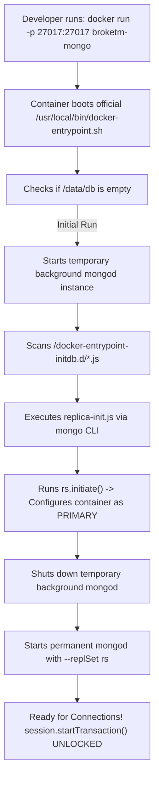

# Docker Containerization of MongoDB Replica Set

> **Job Description Alignment:**  
> *"Familiarity with DevOps principles, including cloud hosting and deployment on GCP or AWS... Proficiency in Linux and command-line interface (CLI)."*

---

## 1. The 30-Second Interview Pitch

> *"MongoDB requires a Replica Set for multi-document ACID transactions because transactions rely on the replication Oplog (operations log) to manage write-ahead logs, point-in-time snapshots, and rollback points. A standalone MongoDB instance rejects transactional commands.
> 
> To enable local development and automated testing without spinning up a heavy multi-machine cluster, we containerized MongoDB using a custom `Dockerfile` based on `mongo:4.4.7`.
> 
> The Docker container starts the MongoDB process with `--replSet rs` and injects an automated JavaScript initialization script into `/docker-entrypoint-initdb.d/` running `rs.initiate()`. When the container boots, the entrypoint script executes the script automatically, turning the single container into a fully functional primary replica set with transaction support in under 3 seconds."*

---

## 2. The Core Technical Problem: Standalone vs. Replica Set

If you run a standard local MongoDB instance via `mongod` and execute `session.startTransaction()`, Node.js immediately crashes with this error:

```text
MongoServerError: Transaction numbers are only allowed on a replica set member or mongos
```

### Why Does MongoDB Require a Replica Set for Transactions?
1. **The WiredTiger Oplog:** Standalone MongoDB does not maintain an operations log (`local.oplog.rs`). Without the oplog, the database cannot record the transaction commit timestamp or broadcast rollbacks.
2. **Read & Write Concerns:** Transactions depend on `majority` read and write concerns to guarantee durability across node failures.
3. **Snapshot Timestamps:** When a transaction starts, WiredTiger locks a specific cluster timestamp ($T_{start}$) from the replication stream to ensure consistent reads.

---

## 3. The BrokeTM Docker Implementation

### The Dockerfile (`Dockerfile`)
```dockerfile
FROM mongo:4.4.7
RUN echo "rs.initiate();" > /docker-entrypoint-initdb.d/replica-init.js
CMD [ "--replSet", "rs" ]
```

### Breaking Down Every Single Line

| Dockerfile Instruction | Architectural Purpose | What it Does Under the Hood |
| :--- | :--- | :--- |
| `FROM mongo:4.4.7` | Base official image | Pulls a Debian-based Linux image containing the official MongoDB 4.4 daemon and utilities. |
| `RUN echo "rs.initiate();" > /docker-entrypoint-initdb.d/replica-init.js` | Automated cluster initialization | Injects a one-line JavaScript command into the container initialization directory. The official Mongo entrypoint script automatically executes all `.js` and `.sh` files in this folder upon initial database creation. |
| `CMD [ "--replSet", "rs" ]` | Daemon launch argument | Overrides the default `mongod` command to boot with the replica set flag enabled, naming the replica set `'rs'`. |

---

## 4. Container Lifecycle & Initialization Workflow



---

## 5. Docker CLI Commands & Operational Mastery

Here are the essential Docker commands to master for the interview:

### 1. Building the Custom Image
```bash
docker build -t broketm-mongo:4.4 .
```

### 2. Running the Container with Port Mapping and Volume Persistence
```bash
docker run -d \
  --name broketm-db \
  -p 27017:27017 \
  -v broketm_data:/data/db \
  broketm-mongo:4.4
```
* `-d`: Run in detached background mode.
* `-p 27017:27017`: Map host port 27017 to container port 27017.
* `-v broketm_data:/data/db`: Named volume to persist data across container restarts.

### 3. Inspecting the Replica Set Status via Docker Exec
```bash
docker exec -it broketm-db mongo --eval "rs.status()"
```
Expected output confirms the node is `PRIMARY`:
```json
{
  "set": "rs",
  "members": [
    {
      "_id": 0,
      "name": "127.0.0.1:27017",
      "stateStr": "PRIMARY"
    }
  ],
  "ok": 1
}
```

### 4. Viewing Container Logs and Troubleshooting
```bash
docker logs -f broketm-db
```

---

## 6. Docker Compose Setup (Multi-Service Production Setup)

To run the complete MERN stack (MongoDB + Express Backend + React Frontend) together:

```yaml
version: '3.8'

services:
  database:
    build:
      context: .
      dockerfile: Dockerfile
    ports:
      - "27017:27017"
    volumes:
      - mongo-data:/data/db
    healthcheck:
      test: test $$(echo "rs.status().ok" | mongo --quiet) -eq 1
      interval: 5s
      timeout: 5s
      retries: 5

  backend:
    build: ./backend
    ports:
      - "3000:3000"
    environment:
      - PORT=3000
      - DB_URL=mongodb://database:27017/broketm?replicaSet=rs
      - JWT_SECRET=supersecretjwtkey123
    depends_on:
      database:
        condition: service_healthy

  frontend:
    build: ./frontend
    ports:
      - "5173:5173"
    depends_on:
      - backend

volumes:
  mongo-data:
```

> **Interview Note:** Notice the connection string in `docker-compose.yml`:  
> `mongodb://database:27017/broketm?replicaSet=rs`  
> In MongoDB, you **must** append `?replicaSet=rs` to the connection URI so the Mongoose driver initializes replica set discovery and transaction routing!
