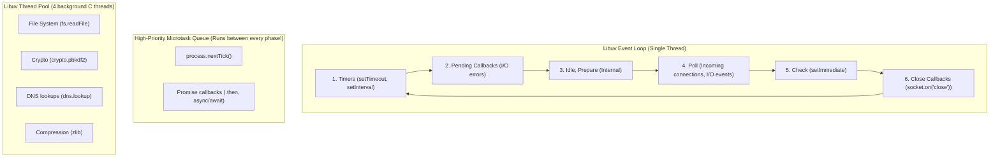

# MERN Stack Internals & The NestJS Architectural Evolution

> **Job Description Requirement:**  
> *"Must have hands-on coding experience and strong practical knowledge of the MERN stack: Node.js, React.js, MongoDB, NestJS, Express.js, and related technologies."*

---

## 1. The 30-Second Interview Pitch

> *"The MERN stack unites JavaScript across the entire client-server continuum, combining React's reactive Virtual DOM with Node.js and Express's asynchronous event-driven I/O and MongoDB's flexible document model.
> 
> However, as an application scales from a lightweight prototype to an enterprise financial engine, raw Express reaches its limits due to its lack of architectural convention, manual dependency wiring, and scattered middleware.
> 
> In enterprise engineering, we evolve Express architectures into **NestJS**. NestJS retains Express (or Fastify) under the hood, but introduces a structured, modular TypeScript architecture inspired by Angular and Spring Boot:
> 1. **Dependency Injection (IoC Container):** Inverting control so services are decoupled and easily mocked for testing.
> 2. **Domain Modules:** Encapsulating related controllers, services, and repositories into cleanly bounded units (`AuthModule`, `AccountsModule`).
> 3. **Pipeline Decorators:** Native Pipes for DTO validation, Guards for role authorization, and Interceptors for logging and distributed tracing."*

---

## 2. Deep Dive: Node.js Runtime & The Libuv Event Loop

Node.js is single-threaded for JavaScript execution, but achieves high throughput and non-blocking I/O by delegating OS-level operations to the **libuv** C library and its background thread pool (default 4 threads).



### Key Interview Concept: Microtasks vs. Macrotasks
* **Microtask Queue:** Holds `process.nextTick` callbacks and resolved `Promise` handlers (`async/await`). The microtask queue is drained **immediately** after the currently executing operation finishes, before the event loop advances to the next phase!
* **Macrotask Queue:** Holds `setTimeout`, `setInterval`, and I/O callbacks.
* **Why this matters in BrokeTM:** When awaiting `session.startTransaction()` or `Account.updateOne()`, Node.js releases the event loop thread to process other incoming HTTP requests. When the database driver returns results, the Promise resumes execution in the microtask queue with minimal latency.

---

## 3. React Internals: Virtual DOM & Reconciliation

In the BrokeTM frontend:
1. **Virtual DOM:** A lightweight in-memory JavaScript representation of the actual DOM tree.
2. **Reconciliation (Fiber Engine):** When state changes (e.g., balance updates after a transfer), React creates a new Virtual DOM tree and diffs it against the previous tree using a heuristic $O(n)$ diffing algorithm.
3. **Batching:** Multiple state updates are batched into a single render pass to prevent UI thrashing.

---

## 4. Architectural Comparison: Express.js vs. NestJS

| Feature | Express.js (BrokeTM Monolith) | NestJS (Enterprise Evolution) |
| :--- | :--- | :--- |
| **Philosophy** | Minimalist, unopinionated routing library | Enterprise, highly opinionated, structured framework |
| **Language** | Plain JavaScript or optional TypeScript | First-class TypeScript with decorators and metadata reflection |
| **Dependency Management** | Manual `require()` / `import`, manual object instantiation | Built-in Dependency Injection (Inversion of Control container) |
| **Validation** | Manual middleware with Zod / Joi | Declarative DTOs with `class-validator` and `@UsePipes(ValidationPipe)` |
| **Authorization** | Ad-hoc middleware (`authMiddleware`) | Reusable `@UseGuards(AuthGuard)` with execution context |
| **Testing** | Difficult to isolate unit tests; heavy mocking of modules | Easy unit testing with auto-mocked DI providers |
| **Microservices** | Requires manual socket / HTTP orchestration | Native microservices support (gRPC, Kafka, RabbitMQ, NATS, Redis) |

---

## 5. Side-by-Side Code Evolution: BrokeTM Express to NestJS

### Scenario: The Account Balance Endpoint

#### The Express Implementation (`BrokeTM/backend/routes/account.js`)
```javascript
const express = require('express');
const router = express.Router();
const { authMiddleware } = require('../middlewares/middleware');
const { Account } = require('../db');

router.get('/balance', authMiddleware, async (req, res) => {
    try {
        const account = await Account.findOne({ userId: req.userId });
        if (!account) {
            return res.status(404).json({ message: "Account not found" });
        }
        res.json({ balance: account.balance });
    } catch (error) {
        res.status(500).json({ message: "Server error" });
    }
});
```

#### The NestJS Implementation (Production Architecture)

**1. The Account DTO (`src/accounts/dto/transfer.dto.ts`):**
```typescript
import { IsNotEmpty, IsNumber, IsPositive, IsString } from 'class-validator';

export class TransferDto {
    @IsString()
    @IsNotEmpty()
    to: string;

    @IsNumber()
    @IsPositive({ message: 'Transfer amount must be strictly positive' })
    amount: number;
}
```

**2. The Injected Service (`src/accounts/accounts.service.ts`):**
```typescript
import { Injectable, BadRequestException, NotFoundException } from '@nestjs/common';
import { InjectModel } from '@nestjs/mongoose';
import { Model, Connection } from 'mongoose';
import { Account, AccountDocument } from './schemas/account.schema';
import { TransferDto } from './dto/transfer.dto';

@Injectable()
export class AccountsService {
    constructor(
        @InjectModel(Account.name) private accountModel: Model<AccountDocument>,
        private connection: Connection
    ) {}

    async getBalance(userId: string): Promise<number> {
        const account = await this.accountModel.findOne({ userId });
        if (!account) throw new NotFoundException('Account not found');
        return account.balance;
    }

    async transfer(fromUserId: string, transferDto: TransferDto): Promise<void> {
        const session = await this.connection.startSession();
        session.startTransaction();

        try {
            const sender = await this.accountModel.findOne({ userId: fromUserId }).session(session);
            if (!sender || sender.balance < transferDto.amount) {
                throw new BadRequestException('Insufficient balance');
            }

            const recipient = await this.accountModel.findOne({ userId: transferDto.to }).session(session);
            if (!recipient) {
                throw new BadRequestException('Recipient account does not exist');
            }

            await this.accountModel.updateOne(
                { userId: fromUserId },
                { $inc: { balance: -transferDto.amount } }
            ).session(session);

            await this.accountModel.updateOne(
                { userId: transferDto.to },
                { $inc: { balance: transferDto.amount } }
            ).session(session);

            await session.commitTransaction();
        } catch (error) {
            await session.abortTransaction();
            throw error;
        } finally {
            session.endSession();
        }
    }
}
```

**3. The Controller with Decorators & Guards (`src/accounts/accounts.controller.ts`):**
```typescript
import { Controller, Get, Post, Body, UseGuards, Req } from '@nestjs/common';
import { AccountsService } from './accounts.service';
import { JwtAuthGuard } from '../auth/guards/jwt-auth.guard';
import { TransferDto } from './dto/transfer.dto';

@Controller('api/v1/account')
@UseGuards(JwtAuthGuard)
export class AccountsController {
    constructor(private readonly accountsService: AccountsService) {}

    @Get('balance')
    async getBalance(@Req() req) {
        const balance = await this.accountsService.getBalance(req.user.userId);
        return { balance };
    }

    @Post('transfer')
    async transfer(@Req() req, @Body() transferDto: TransferDto) {
        await this.accountsService.transfer(req.user.userId, transferDto);
        return { message: 'Transfer successful' };
    }
}
```

**4. The Domain Module (`src/accounts/accounts.module.ts`):**
```typescript
import { Module } from '@nestjs/common';
import { MongooseModule } from '@nestjs/mongoose';
import { AccountsController } from './accounts.controller';
import { AccountsService } from './accounts.service';
import { Account, AccountSchema } from './schemas/account.schema';

@Module({
    imports: [MongooseModule.forFeature([{ name: Account.name, schema: AccountSchema }])],
    controllers: [AccountsController],
    providers: [AccountsService],
    exports: [AccountsService]
})
export class AccountsModule {}
```

---

## 6. Why This Impression Crushes the Interview
When you explain this transition to an interviewer:
1. You demonstrate that while you built BrokeTM in Express to master the raw foundational HTTP and database mechanics, you fully grasp enterprise NestJS patterns (IoC, Modules, DTOs, Pipes, Guards).
2. You prove you know how to write production-grade, maintainable code ready for scale.
