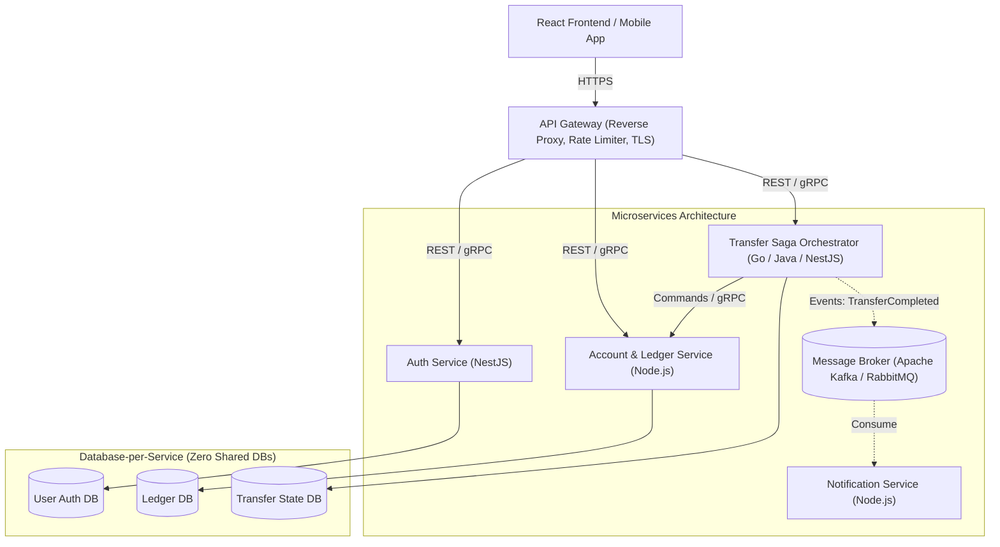
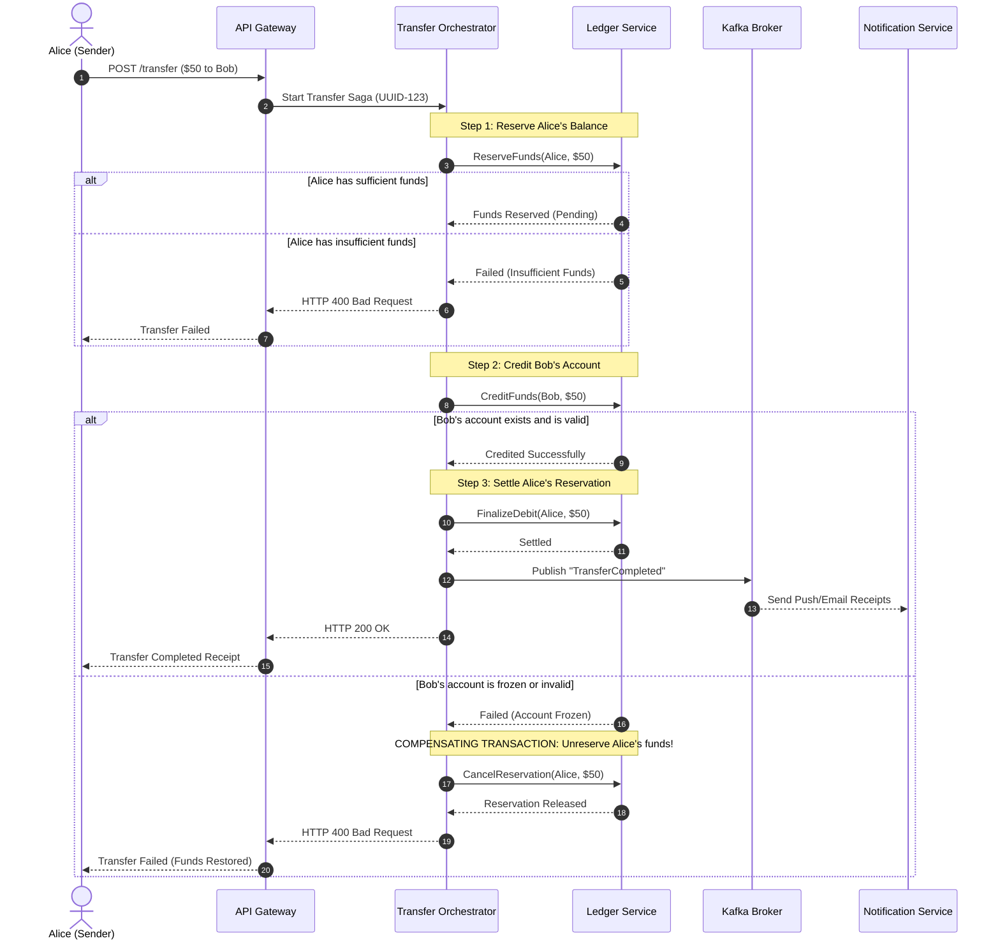
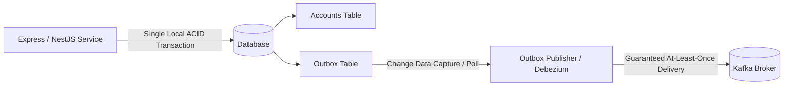

# Microservices Architecture & Distributed System Design for BrokeTM

> **Job Description Requirements:**  
> *"Understanding of microservices architecture... Strong focus on distributed back-end system design."*

---

## 1. The 30-Second Interview Pitch

> *"In BrokeTM, we started with a monolithic architecture because single-database ACID transactions make consistency straightforward. However, as transactions scale to millions per day, a shared database becomes a bottleneck and single point of failure.
> 
> To scale BrokeTM into a distributed microservices architecture, we decompose the system into 4 independent domain services:
> 1. **Auth Service:** Manages user identities and token issuance.
> 2. **Account & Ledger Service:** Authoritative owner of account balances, storing an immutable double-entry journal.
> 3. **Payment Orchestration Service:** Coordinates multi-step transfers.
> 4. **Notification Service:** Asynchronously alerts users of transaction receipts.
> 
> Because distributed services follow the **Database-per-Service** pattern, single-database ACID transactions cannot span service boundaries. We replace 2-Phase Commit with the **Saga Pattern (Orchestrated)**: executing local transactions sequentially and triggering automated compensating actions if any downstream service fails."*

---

## 2. Monolith Decomposition: Bounded Contexts

---

## 3. The Core Distributed Problem: Why Not 2-Phase Commit (2PC)?

When decomposing services with separate databases, junior engineers often suggest **Two-Phase Commit (2PC)**:
1. **Prepare Phase:** Coordinator asks Service A and Service B if they are ready to commit.
2. **Commit Phase:** If both say yes, the coordinator tells both to commit.

### Why 2PC Fails in High-Scale Distributed Systems:
1. **Blocking Coordinator Failure:** If the coordinator crashes during the prepare phase, participating services must hold database locks indefinitely, starving all incoming traffic.
2. **High Latency:** Network round trips multiply. The system is only as fast as its slowest service.
3. **Breaks Service Autonomy:** Microservices cannot deploy or scale independently if they are bound to global distributed locks.

---

## 4. The Solution: The Saga Pattern

A Saga is a sequence of local transactions where each transaction updates data within a single service. If a local transaction fails because it violates a business rule, the Saga executes a series of **compensating transactions** that undo the changes that were made by the preceding local transactions.

### Orchestrated Saga Workflow for BrokeTM Transfers

---

## 5. The Transactional Outbox Pattern

In microservices, when a service updates its database and sends an event to a message broker (e.g., Kafka or RabbitMQ), a dual-write failure can occur:
- The database update succeeds, but the server crashes before sending the event.
- The event is sent, but the database update fails.

### How the Outbox Pattern Guarantees Consistency
Instead of publishing directly to Kafka from within the HTTP handler:
1. The service writes the business data **and** an outbox event into an `outbox` table in the **same local database transaction**.
2. A lightweight background relay process (e.g., Debezium using Change Data Capture / CDC, or a polling worker) reads uncommitted rows from the outbox table and publishes them to the message broker.
3. Once the broker acknowledges receipt, the relay marks the outbox record as sent.

---

## 6. Distributed Consistency Comparison

| Approach | Consistency Model | Availability | Latency | Complexity | Best For |
| :--- | :--- | :--- | :--- | :--- | :--- |
| **Monolith (BrokeTM Current)** | Strict ACID | Low (Single DB bottleneck) | Sub-5ms | Low | MVPs, low-to-medium scale, prototypes |
| **Two-Phase Commit (2PC)** | Distributed ACID | Very Low (Blocks on failures) | High (Multi-phase locks) | High | Legacy enterprise banking databases |
| **Orchestrated Saga** | Eventual Consistency | High (Services decouple) | Low (Non-blocking) | Medium | High-scale modern fintech (e.g., Stripe, Uber) |
| **Choreographed Saga** | Eventual Consistency | Very High | Extremely Low | High (Hard to trace) | Simple 2-step event chains |
