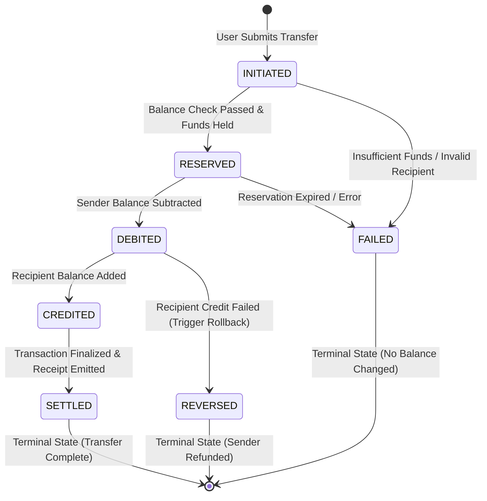

# State Machine Design & Architecture: Complete Guide & BrokeTM Payment Case Study

> **Job Description Requirement:**  
> *"Knowledge of state-machine design and architecture."*

---

## 1. The 30-Second Interview Pitch

> *"A State Machine (Finite State Machine, or FSM) models an entity's lifecycle through a finite set of mutually exclusive states, allowed transitions, transition guards, and automated side effects. In financial software, treating transaction status as a loose string allows catastrophic bugs—such as executing refunds on unconfirmed deposits or marking failed payments as settled.
> 
> In BrokeTM, we govern the payment lifecycle using a strict 6-state FSM:
> `INITIATED` $\rightarrow$ `RESERVED` $\rightarrow$ `DEBITED` $\rightarrow$ `CREDITED` $\rightarrow$ `SETTLED` (with `FAILED` and `REVERSED` as terminal fallback states).
> 
> Any illegal transition—such as jumping from `INITIATED` directly to `SETTLED` without passing through the reservation and debit guards—is rejected with an HTTP 400. Furthermore, transitions trigger atomic side effects: transitioning to `REVERSED` executes an atomic database rollback restoring the sender's balance and writing an immutable audit log entry."*

---

## 2. What is a State Machine (Explained Simply)?

### 🚦 The Real-World Analogy: The Bank Check Clearance Lifecycle

When you deposit a paper check at a bank, money doesn't instantly appear as cleared cash:
1. **Initial State (`DEPOSITED`):** The bank acknowledges they received the paper check.
2. **State 2 (`VERIFYING`):** Bank clerks inspect signatures and verify the routing number.
3. **State 3 (`FUNDS_ON_HOLD`):** The originating bank confirms funds exist and freezes them.
4. **State 4 (`CLEARED`):** Funds are moved to your account. This is a **terminal state**.
5. **Alternative State (`BOUNCED`):** If the issuer has insufficient funds, the check bounces. The hold is cancelled. This is also a **terminal state**.

**What a State Machine Prevents:**
- A customer cannot ask the bank to "Bounce" a check that has already entered `CLEARED`!
- The bank cannot mark a check `CLEARED` before it has entered `FUNDS_ON_HOLD`!

---

## 3. Core Building Blocks of a State Machine

| Building Block | Technical Definition | BrokeTM Payment Implementation |
| :--- | :--- | :--- |
| **1. States ($S$)** | Finite, mutually exclusive lifecycle conditions. | `INITIATED`, `RESERVED`, `DEBITED`, `CREDITED`, `SETTLED`, `FAILED`, `REVERSED`. |
| **2. Initial State** | The state assigned upon record creation. | When `/transfer` is received, initial state is strictly `'INITIATED'`. |
| **3. Events / Triggers ($E$)** | Actions that request a state transition. | `RESERVE_FUNDS`, `DEBIT_SENDER`, `CREDIT_RECIPIENT`, `ABORT_TRANSFER`. |
| **4. Transitions ($T$)** | Valid directed paths from State A to State B. | `INITIATED` $\rightarrow$ `RESERVED`, `RESERVED` $\rightarrow$ `DEBITED`. |
| **5. Guards ($G$)** | Boolean preconditions that must evaluate to TRUE. | *Guard:* Sender balance must be $\ge$ transfer amount before moving from `INITIATED` to `RESERVED`. |
| **6. Actions / Side-Effects ($A$)** | Atomic mutations executed during a transition. | On transition to `DEBITED`, subtract \$amount from sender's ledger and log timestamp. |
| **7. Terminal States** | Final states with 0 outgoing transitions. | `SETTLED`, `FAILED`, `REVERSED`. Once reached, no further transitions are allowed. |

---

## 4. BrokeTM Payment State Machine Diagram



---

## 5. Transition Matrix

A transition matrix defines every legal path through the system. Any transition not explicitly listed in this table is strictly forbidden.

| Current State | Allowed Next States | Trigger Event | Guard Condition | Side Effect |
| :--- | :--- | :--- | :--- | :--- |
| `INITIATED` | `RESERVED` | `HOLD_FUNDS` | Sender balance $\ge$ amount | Lock funds in reservation bucket |
| `INITIATED` | `FAILED` | `REJECT_REQUEST` | Balance insufficient or recipient invalid | Emit 400 error |
| `RESERVED` | `DEBITED` | `EXECUTE_DEBIT` | Reservation lock active | Deduct sender balance |
| `RESERVED` | `FAILED` | `TIMEOUT` | Lock timeout expired | Release reservation |
| `DEBITED` | `CREDITED` | `EXECUTE_CREDIT` | Recipient account active | Add recipient balance |
| `DEBITED` | `REVERSED` | `CREDIT_FAILED` | Recipient write failed | Trigger compensation refund to sender |
| `CREDITED` | `SETTLED` | `FINALIZE` | Both balances updated | Generate immutable receipt |

---

## 6. Implementation in Code: The FSM Engine

Here is how an explicit State Machine is implemented in JavaScript/TypeScript to eliminate status bugs:

```javascript
// Allowed transitions lookup table
const TRANSFER_TRANSITIONS = {
    INITIATED: ['RESERVED', 'FAILED'],
    RESERVED: ['DEBITED', 'FAILED'],
    DEBITED: ['CREDITED', 'REVERSED'],
    CREDITED: ['SETTLED'],
    SETTLED: [],  // Terminal
    FAILED: [],   // Terminal
    REVERSED: []  // Terminal
};

async function transitionTransfer(transferId, targetState, session, sideEffectFn) {
    // 1. Fetch current transfer state with session
    const transfer = await Transfer.findById(transferId).session(session);
    if (!transfer) throw new Error("Transfer record not found");

    const currentState = transfer.status;

    // 2. Validate transition legality against transition matrix
    const allowedNextStates = TRANSFER_TRANSITIONS[currentState] || [];
    if (!allowedNextStates.includes(targetState)) {
        throw new Error(`Illegal state transition: Cannot move from ${currentState} to ${targetState}`);
    }

    // 3. Execute atomic side effect (debit, credit, rollback)
    if (sideEffectFn) {
        await sideEffectFn();
    }

    // 4. Update status with optimistic version check
    const updated = await Transfer.findOneAndUpdate(
        { _id: transferId, status: currentState },
        { 
            $set: { status: targetState },
            $inc: { version: 1 },
            $push: { 
                auditLog: { 
                    from: currentState, 
                    to: targetState, 
                    timestamp: new Date() 
                } 
            }
        },
        { session, new: true }
    );

    if (!updated) {
        throw new Error("Concurrent state modification conflict detected");
    }

    return updated;
}
```

---

## 7. Audit Logging & Immutable Invariants

In financial platforms, you must maintain an immutable paper trail:
1. **Who triggered the transition:** User ID or automated system worker.
2. **When it occurred:** High-resolution ISO timestamp.
3. **Why it transitioned:** Reason code (e.g., `'INSUFFICIENT_FUNDS'`, `'NORMAL_COMPLETION'`).
4. **State Snapshot:** Balances before and after the transition.

By coupling the state machine to an audit log table, any discrepancy or customer dispute can be reconstructed with 100% forensic accuracy.
