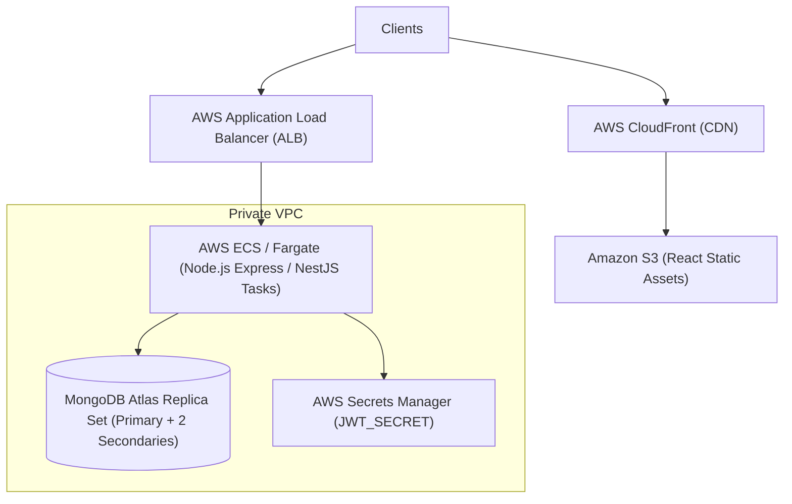

# DevOps, Cloud Hosting (AWS/GCP), Linux CLI & Systems Architecture

> **Job Description Requirements:**  
> - *"Proficiency in Linux and command-line interface (CLI), including scripting and system commands."*  
> - *"Familiarity with DevOps principles, including cloud hosting and deployment on GCP or AWS."*  
> - *"Experience using GitHub or Bitbucket for version control and collaboration."*  
> - *"Good-to-have proficiency in C++ or Java."*

---

## 1. Linux & CLI Mastery for Backend Engineers

In modern cloud and backend operations, everything runs inside Linux containers. You must be able to diagnose stuck processes, memory leaks, open socket leaks, and network timeouts directly from the shell.

### Essential Linux Commands for Backend Debugging

| Command | Practical Backend Usage Scenario |
| :--- | :--- |
| `lsof -i :3000` | Find which process is occupying port 3000 (`EADDRINUSE` error). |
| `netstat -tulnp` / `ss -tulpn` | Display all listening TCP/UDP sockets and their associated PIDs. |
| `ps aux \| grep node` | List all running Node.js processes, memory percentage, and PIDs. |
| `kill -15 <PID>` (SIGTERM) | Send a graceful shutdown signal allowing Node.js to finish active database queries. |
| `kill -9 <PID>` (SIGKILL) | Forcefully terminate an unkillable process at the kernel level. |
| `top` / `htop` | Real-time monitoring of CPU core usage, load averages, and memory consumption. |
| `df -h` & `du -sh *` | Check disk space usage when MongoDB logs fill up the disk. |
| `tail -n 100 -f app.log` | Follow live application log output in real time. |
| `curl -X POST -H "Content-Type: application/json" -d '{"amount":50}' http://localhost:3000/api/v1/account/transfer` | Test backend endpoints directly from the command line without a browser. |

### Bash Automation Script: Checking Replica Set Health
```bash
#!/bin/bash
# check_mongo_health.sh - Automated health check script for BrokeTM MongoDB replica set

CONTAINER_NAME="broketm-db"
STATUS=$(docker exec $CONTAINER_NAME mongo --quiet --eval "rs.status().ok" 2>/dev/null)

if [ "$STATUS" == "1" ]; then
    echo "[$(date '+%Y-%m-%d %H:%M:%S')] [SUCCESS] MongoDB Replica Set is healthy and PRIMARY."
    exit 0
else
    echo "[$(date '+%Y-%m-%d %H:%M:%S')] [CRITICAL] MongoDB Replica Set is unhealthy! Restarting container..."
    docker restart $CONTAINER_NAME
    exit 1
fi
```

---

## 2. Cloud Hosting & Deployment: AWS vs. GCP

### ☁️ AWS Production Deployment Architecture
* **Frontend:** React static build (`npm run build`) hosted on **Amazon S3** and distributed globally via **Amazon CloudFront** CDN with TLS termination.
* **Backend:** Express/NestJS Node.js application containerized with Docker, deployed onto **AWS ECS (Elastic Container Service) with AWS Fargate** (serverless container compute) behind an **Application Load Balancer (ALB)**.
* **Database:** Managed **MongoDB Atlas on AWS** (or **Amazon DocumentDB** with replica sets enabled), placed within a private VPC with VPC Peering.
* **Secrets:** Sensitive credentials (`JWT_SECRET`, database connection URIs) stored in **AWS Secrets Manager** or **AWS Systems Manager (SSM) Parameter Store**.



### ☁️ GCP Production Deployment Architecture
* **Frontend:** Static assets hosted on **Google Cloud Storage (GCS)** behind **Cloud CDN**.
* **Backend:** Containerized Express/NestJS microservices deployed to **Google Cloud Run** (fully managed autoscaling serverless containers from 0 to 1000+ instances) or **Google Kubernetes Engine (GKE)**.
* **Database:** MongoDB Atlas on GCP via private Service Networking.
* **Secrets:** Injected into Cloud Run containers via **GCP Secret Manager**.

---

## 3. DevOps Principles & CI/CD Pipelines

### What is DevOps?
DevOps is the combination of cultural philosophies, practices, and tools that increases an organization's ability to deliver applications and services at high velocity.

### Automated GitHub Actions CI/CD Pipeline (`.github/workflows/deploy.yml`)
```yaml
name: BrokeTM CI/CD Pipeline

on:
  push:
    branches: [ main ]
  pull_request:
    branches: [ main ]

jobs:
  test:
    name: Run Unit & Transactional Tests
    runs-on: ubuntu-latest
    steps:
      - uses: actions/checkout@v4

      - name: Setup Node.js 20
        uses: actions/setup-node@v4
        with:
          node-version: 20
          cache: 'npm'

      - name: Start MongoDB Replica Set via Docker
        run: |
          docker build -t broketm-mongo .
          docker run -d --name test-mongo -p 27017:27017 broketm-mongo
          sleep 5

      - name: Install Backend Dependencies & Run Tests
        working-directory: ./backend
        run: |
          npm ci
          npm test

  build-and-deploy:
    name: Build & Deploy Container
    needs: test
    if: github.ref == 'refs/heads/main'
    runs-on: ubuntu-latest
    steps:
      - uses: actions/checkout@v4

      - name: Log in to Docker Hub / AWS ECR
        uses: docker/login-action@v3
        with:
          username: ${{ secrets.DOCKER_USERNAME }}
          password: ${{ secrets.DOCKER_PASSWORD }}

      - name: Build and Push Backend Docker Image
        uses: docker/build-push-action@v5
        with:
          context: ./backend
          push: true
          tags: user/broketm-backend:latest
```

---

## 4. Version Control: GitHub & Bitbucket Collaboration

### Branching Strategies: Trunk-Based Development vs. GitFlow
* **GitFlow:** Strict branch isolation with `feature/*`, `develop`, `release/*`, and `master`. Good for traditional release cycles with scheduled deployment dates.
* **Trunk-Based Development (Recommended for Modern Teams):** Developers merge short-lived feature branches into `main` multiple times a day through small, focused Pull Requests (PRs). Coupled with automated CI/CD for continuous deployment.

### Pull Request & Code Review Best Practices
1. **Branch Protection Rules:** Require CI test suites to pass and require at least 1 senior code review approval before merging into `main`.
2. **Atomic Commits:** Small, single-purpose commits with semantic messages (`feat: add transfer idempotency check`, `fix: abort transaction on recipient lookup error`).
3. **Merge vs. Rebase:** Use **Squash and Merge** on GitHub/Bitbucket to keep the `main` git history linear and clean.

---

## 5. Systems Engineering: C++ & Java vs. Node.js

> **Job Description Note:** *"Good-to-have proficiency in C++ or Java."*

Interviewers love to ask:  
*"Why do Wall Street trading desks and high-frequency payment networks use C++ or Java instead of Node.js?"*

### 1. Memory Management & Garbage Collection (GC)
* **Node.js (V8) & Java:** Rely on Garbage Collection (V8 Scavenger/Mark-Sweep, Java G1/ZGC). During heavy garbage collection sweeps, the runtime can experience **Stop-the-World GC pauses** (50ms–500ms). In high-frequency financial trading, a 100ms pause means losing millions of dollars.
* **C++:** Uses deterministic manual memory management and RAII (`Resource Acquisition Is Initialization`). Memory is freed the instant a variable leaves scope (`std::unique_ptr`). Zero garbage collection pauses.

### 2. Concurrency Models: OS Threads vs. Event Loop
* **Node.js:** Single-threaded event loop. Excellent for high-concurrency I/O (waiting for database/network), but CPU-heavy operations (e.g., complex risk calculations or cryptography) block the entire server thread!
* **Java:** Multi-threaded OS threads and modern **Virtual Threads (Project Loom in Java 21)**. Thousands of concurrent lightweight fibers can run CPU and I/O calculations concurrently across all CPU cores.
* **C++:** Native OS threads (`std::jthread`), atomics (`std::atomic`), lock-free queues, and hardware-level memory barriers for sub-microsecond latency.

### How BrokeTM Compares
Node.js was the ideal choice for BrokeTM because peer-to-peer payment transfers are predominantly **I/O-bound** (querying MongoDB, network serialization, HTTP routing). For the core transactional ledger, the concurrency bottleneck is database serialization, not CPU arithmetic.
