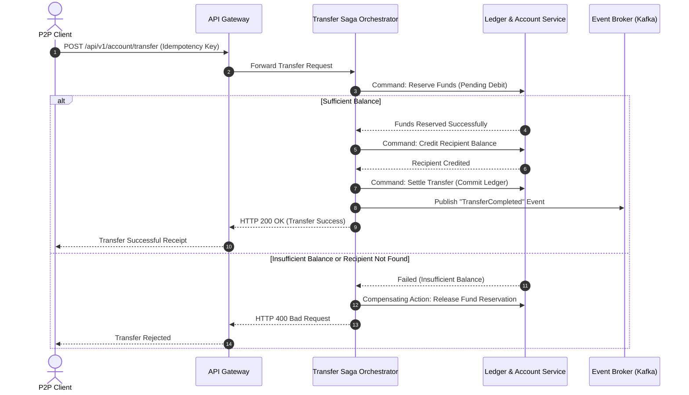

# BrokeTM — Comprehensive Technical Interview Preparation Guide

This guide is designed for engineering interviews defending the technical architecture, design decisions, and implementation claims of **BrokeTM**. It is grounded directly in the repository source code, MongoDB transactional schemas, Docker containerization workflows, and the technical requirements of high-scale backend engineering.

### 📚 Interview Suite Index
- [README.md](README.md) — Master Q&A guide (Core technical questions, spoken pitches, codebase anchors, failure defense, and 5-minute cheat sheet).
- [01-broketm-core-interview-playbook.md](01-broketm-core-interview-playbook.md) — Core technical playbook with detailed walkthroughs of all resume bullet points.
- [02-mongodb-transactions-and-acid.md](02-mongodb-transactions-and-acid.md) — Deep dive into MongoDB Multi-Document ACID Transactions, Mongoose sessions (`session.startTransaction()`), WiredTiger write concerns (`w: "majority"`), and two-phase commits.
- [03-concurrency-and-double-spending.md](03-concurrency-and-double-spending.md) — Concurrency control, race conditions, double-spending prevention, atomic `$inc` updates with filter guards, and optimistic vs. pessimistic locking.
- [04-docker-mongodb-replica-set.md](04-docker-mongodb-replica-set.md) — Containerizing a single-node MongoDB Replica Set (`--replSet rs`, `rs.initiate()`), automating transactional support locally, and Docker networking.
- [05-authentication-jwt-and-zod.md](05-authentication-jwt-and-zod.md) — JWT lifecycle, Bearer token extraction, custom Express route-guards, password hashing security, and Zod runtime schema validation.
- [06-mern-stack-and-nestjs-architecture.md](06-mern-stack-and-nestjs-architecture.md) — MERN stack architecture, Node.js libuv event loop, React virtual DOM, and a deep architectural transition guide from Express.js to NestJS (Modules, Controllers, Providers, DTOs, Pipes, Guards).
- [07-microservices-and-distributed-systems.md](07-microservices-and-distributed-systems.md) — Monolith-to-microservices decomposition for payments: API Gateway, Auth Service, Account/Ledger Service, Transfer Service, Saga Pattern (Orchestrated vs Choreographed), and Transactional Outbox Pattern.
- [08-payment-state-machine-architecture.md](08-payment-state-machine-architecture.md) — State machine design for financial transactions: 7-state transfer lifecycle (`INITIATED` → `SETTLED`), transition matrices, rollbacks, and double-entry immutable ledgers.
- [09-devops-cloud-and-linux.md](09-devops-cloud-and-linux.md) — Linux CLI mastery for backend systems, process monitoring, Docker deployment, AWS (ECS/DocumentDB) vs GCP (Cloud Run/GKE), and CI/CD pipelines.
- [10-interview-strategy-and-cheat-sheet.md](10-interview-strategy-and-cheat-sheet.md) — 10–15 minute interview game plan (90s elevator pitch, STAR bug story, "Where does it break at 10,000 TPS?", and spoken defense scripts).
- **Subfolder Deep Dives:**
  - [deep-dives/01-distributed-transactions-saga.md](deep-dives/01-distributed-transactions-saga.md) — Saga pattern vs Two-Phase Commit (2PC), compensating transactions, and distributed deadlock avoidance.
  - [deep-dives/02-financial-ledger-double-entry.md](deep-dives/02-financial-ledger-double-entry.md) — Production financial ledger design: Double-entry bookkeeping, debit/credit invariants, immutable audit trails, and reconciliation jobs.
  - [deep-dives/03-linux-cli-mastery.md](deep-dives/03-linux-cli-mastery.md) — Advanced Linux commands, shell scripting, socket inspection (`ss`, `lsof`), signals, and performance profiling.

---

## 🧠 The 3-Step Delivery Framework (How to Speak)

When an interviewer asks you about an architecture or system design topic, avoid jumping straight into generic textbook definitions. Deliver your answer in three distinct layers:

1. **The Executive Pitch (15–20s):** State *what* it is and the primary architectural rationale (*why* you chose it).
2. **The BrokeTM Implementation (20–30s):** Cite the exact files, database collections, queries, and logic in the repository (proves you actually built and debugged it).
3. **The Edge-Case & Failure Defense (15–20s):** Explain how the system handles failure modes (network partitions, race conditions, abort transactions, rollbacks, idempotency).

---

# Part A: Core Full-Stack Architecture, Database & Transactions

---

### Question 1: Explain BrokeTM's Architecture
#### 🎯 The Spoken Answer
> *"BrokeTM is a full-stack peer-to-peer payments application designed to execute atomic, concurrency-safe money transfers and account management between authenticated users.
> 
> Architecturally, it is structured as a client-server web platform:
> - **Frontend:** A React single-page application styled with Tailwind CSS, utilizing component-driven architecture for user search, real-time balance displays, and transfer modals.
> - **Backend:** A Node.js and Express REST API implementing layered route handlers, token verification middleware, and strict input validation via Zod.
> - **Data & Transactional Layer:** MongoDB backed by Mongoose ODM. Because financial ledger debits and credits must be completely indivisible to prevent double-spending, all fund transfers run inside multi-document ACID transactions managed via explicit Mongoose client sessions.
> - **Containerized Development Environment:** A customized Docker container running MongoDB 4.4+ initialized with a single-node Replica Set (`--replSet rs`) to support multi-document transactional semantics locally without needing a multi-server cloud deployment."*

#### 💻 Under the Hood in BrokeTM
* **Backend Entry Point (`backend/index.js`):** Express app mounting CORS, `express.json()`, and root router `/api/v1` (`backend/routes/index.js`).
* **Database Models (`backend/db.js`):**
  - `UserSchema`: `username` (lowercase, trimmed, unique email), `firstName`, `lastName`, `password`.
  - `accountSchema`: `userId` (referencing `User._id`), `balance` (stored as integer/number).
* **Transfer Engine (`backend/routes/account.js` lines 68–110):**
  ```javascript
  router.post('/transfer', authMiddleware, async (req, res) => {
    const session = await mongoose.startSession();
    session.startTransaction();
    // 1. Fetch sender with session
    // 2. Validate sender balance >= amount
    // 3. Validate recipient account existence
    // 4. Atomic decrement sender ($inc: -amount)
    // 5. Atomic increment recipient ($inc: +amount)
    // 6. Commit or abort transaction
  });
  ```
* **Authentication & Validation (`backend/middlewares/middleware.js`):**
  - `authMiddleware`: Extracts JWT from `Authorization: Bearer <token>`, verifies with `jsonwebtoken`, sets `req.userId`.
  - `userSchema`, `signinBody`, `updatedBody`: Zod runtime schemas enforcing strict payload contracts.

---

### Question 2: Why Did BrokeTM Need MongoDB Multi-Document Transactions?
#### 🎯 The Spoken Answer
> *"In a peer-to-peer payment, transferring money is never a single database write—it is a two-sided financial operation. You must decrement the sender's balance and increment the recipient's balance across two separate documents in the `accounts` collection.
> 
> In traditional NoSQL without transactions, MongoDB only guarantees atomicity at the **single document** level. If the server crashes, encounters an unhandled exception, or loses network connectivity immediately after debiting the sender but before crediting the recipient, money vanishes into thin air.
> 
> To guarantee strict ACID compliance, we wrapped the balance validation, sender debit, and recipient credit inside a Mongoose session transaction (`session.startTransaction()`). If any step fails—such as the recipient account not existing or the sender having insufficient funds—the transaction calls `session.abortTransaction()`, rolling back any partial mutations so account balances remain mathematically consistent."*

#### 💻 Under the Hood in BrokeTM
* In `backend/routes/account.js`:
  ```javascript
  const session = await mongoose.startSession();
  session.startTransaction();

  const account = await Account.findOne({ userId: req.body.userId }).session(session);
  if (!account || account.balance < amount) {
    await session.abortTransaction();
    return res.status(400).json({ message: 'Insufficient balance' });
  }

  const toAccount = await Account.findOne({ userId: to }).session(session);
  if (!toAccount) {
    await session.abortTransaction();
    return res.status(400).json({ message: 'Invalid account' });
  }

  await Account.updateOne({ userId: req.body.userId }, { $inc: { balance: -amount } }).session(session);
  await Account.updateOne({ userId: to }, { $inc: { balance: amount } }).session(session);

  await session.commitTransaction();
  ```
* **Crucial Detail:** Notice that every query and update passes `.session(session)`. If any operation omits the session parameter, it executes outside the transactional snapshot!

---

### Question 3: Why was Docker Required for Local MongoDB Transactions?
#### 🎯 The Spoken Answer
> *"MongoDB multi-document ACID transactions require the WiredTiger storage engine's global commit timestamp architecture, which is only enabled when MongoDB runs as a **Replica Set** or a Sharded Cluster. A standalone MongoDB instance (`mongod` without `--replSet`) explicitly throws an error (`Transaction numbers are only allowed on a replica set member or mongos`) if you call `session.startTransaction()`.
> 
> In local development, spinning up a full multi-node MongoDB cluster is resource-heavy and complex. We solved this by containerizing MongoDB with a custom `Dockerfile` that starts MongoDB with `--replSet rs` and injects an automated initialization script into `/docker-entrypoint-initdb.d/` running `rs.initiate()`. This boots a self-contained, single-node replica set automatically on container startup, enabling multi-document ACID transactions locally without manual cluster setup."*

#### 💻 Under the Hood in BrokeTM
* **Dockerfile (`Dockerfile`):**
  ```dockerfile
  FROM mongo:4.4.7
  RUN echo "rs.initiate();" > /docker-entrypoint-initdb.d/replica-init.js
  CMD [ "--replSet", "rs" ]
  ```
* **How It Works:** The official MongoDB image automatically executes any `.js` or `.sh` scripts placed in `/docker-entrypoint-initdb.d/` when the daemon initializes for the first time. The command `--replSet rs` assigns the replica set name, and `rs.initiate()` configures the single node as primary (`PRIMARY`), allowing WiredTiger oplog tracking and transactions.

---

### Question 4: How Do You Prevent Double-Spending and Race Conditions?
#### 🎯 The Spoken Answer
> *"Double-spending occurs when a user initiates two rapid, concurrent transfer requests (for instance, spending $50 twice when their balance is only $50). If both requests read the balance simultaneously before either writes, both see $50 available and both proceed, resulting in an illegal negative balance.
> 
> We defend against this on multiple layers:
> 1. **MongoDB Multi-Document Transaction Isolation:** In WiredTiger, documents modified inside an active transaction take write locks. Concurrent transactions attempting to modify the same account are blocked or throw write-conflict errors, triggering an abort.
> 2. **Atomic MongoDB Decrements with Filter Guards:** Instead of reading the balance into Node.js, doing math, and setting the new balance, we issue an atomic `$inc: { balance: -amount }`. In production, this update query includes a condition `{ userId: senderId, balance: { $gte: amount } }`. This ensures that even under maximum concurrency, the database engine itself enforces non-negative balances at the hardware storage level.
> 3. **Application Idempotency Keys:** Clients supply a unique UUID per transaction in the request header (`Idempotency-Key`). If a duplicate request arrives due to a double-click or network retry, the server identifies the key and returns the cached result without re-executing the transfer."*

---

# Part B: Distributed Systems, Microservices & Job Alignment

---

### Question 5: How Would You Decompose BrokeTM into Microservices?
#### 🎯 The Spoken Answer
> *"In a monolithic payment app, user onboarding, authentication, balance checks, and payment processing run in a single process and share one database. At scale, this creates tight coupling and database lock contention.
> 
> To evolve BrokeTM into a high-availability microservices architecture, we decompose it into 4 bounded contexts:
> 1. **API Gateway:** Reverse proxy handling TLS termination, rate-limiting, and routing.
> 2. **Auth Service (NestJS):** Manages user registrations, password hashing, and JWT issuance.
> 3. **Account & Ledger Service:** The authoritative source of truth for balances, recording immutable double-entry journal entries (debits and credits).
> 4. **Transfer Orchestrator Service:** Coordinates the transfer workflow across services using the **Saga Pattern**.
> 
> Because distributed microservices follow the **Database-per-Service** rule, cross-database ACID transactions are impossible. Instead, we use an **Orchestrated Saga**: the Transfer Orchestrator issues commands to reserve funds in the sender's account, credits the recipient's account, and marks the transaction complete. If any service fails, compensating transactions are dispatched to unreserve or refund the balance."*



---

### Question 6: How Does Express.js Compare to NestJS for Backend Architecture?
#### 🎯 The Spoken Answer
> *"Express is a minimalist, unopinionated routing and middleware library for Node.js. It gives you total freedom, but as a project grows, it lacks standardized architecture—leading to inconsistent folder structures, scattered validation logic, and tightly coupled dependencies.
> 
> NestJS is a progressive, highly opinionated enterprise TypeScript framework built on top of Express (or Fastify). It brings architectural discipline inspired by Angular and Spring Boot:
> 1. **Modular Architecture:** Business logic is organized into self-contained `@Module()` domains (e.g., `AuthModule`, `AccountsModule`, `TransfersModule`).
> 2. **Dependency Injection (IoC):** Classes declare dependencies via constructors (e.g., injecting `AccountsService` into `AccountsController`), making unit testing with mocks effortless.
> 3. **Enterprise Pipeline:** NestJS provides built-in `Pipes` for automatic DTO validation via `class-validator`, `Guards` for role-based authorization, and `Interceptors` for logging and response transformation.
> 
> For BrokeTM, moving to NestJS provides strict compile-time and runtime type safety, clean separation of concerns, and native support for microservices transport layers like gRPC and Kafka."*

---

### Question 7: How Would You Design a State Machine for BrokeTM Transfers?
#### 🎯 The Spoken Answer
> *"A payment must never be treated as a single boolean 'success' or 'failure'. In high-scale financial systems, network timeouts, bank holds, and verification delays mean a transaction must traverse an explicit **Finite State Machine (FSM)**.
> 
> For BrokeTM, the transfer lifecycle consists of 6 states:
> 1. `INITIATED`: Transfer record created with a unique UUID idempotency key; balance check in progress.
> 2. `PENDING_DEBIT`: Sender's account has a balance hold/reservation placed.
> 3. `DEBITED`: Funds subtracted from sender's ledger.
> 4. `CREDITED`: Funds added to recipient's ledger.
> 5. `SETTLED`: Both accounts updated; receipt generated; terminal state.
> 6. `FAILED` / `REVERSED`: If recipient credit fails after sender debit, the FSM triggers an automatic compensating debit rollback; terminal state.
> 
> **Guards & Invariants:** An order in `SETTLED` can never transition to `INITIATED`. State transitions are atomic database operations with state versioning (`WHERE status = 'PENDING_DEBIT' AND version = 2`), preventing race conditions and illegal status jumping."*

---

### ⏱️ 5-Minute Technical Defense Cheat Sheet

| Interview Topic | Key Technical Words to Say | Common Interviewer Trap |
| :--- | :--- | :--- |
| **MongoDB ACID** | Mongoose session, `session.startTransaction()`, WiredTiger snapshot isolation, `abortTransaction()` | *Trap: "Can standalone Mongo do transactions?"* **Answer:** No, requires Replica Set oplog! |
| **Double-Spending** | Atomic `$inc`, filter guard `{ balance: { $gte: amount } }`, optimistic versioning (`__v`), Redis distributed lock | *Trap: "Does `findOne` then `updateOne` prevent race conditions?"* **Answer:** No! Two concurrent reads see same balance without locks. |
| **Replica Set in Docker** | `--replSet rs`, `rs.initiate()`, `/docker-entrypoint-initdb.d/`, single-node primary | *Trap: "Why not run 3 containers?"* **Answer:** Single-node replica set provides full oplog transactional semantics with minimal local RAM. |
| **JWT Security** | `Authorization: Bearer`, secret entropy, signature tampering, expiration (`exp`), stateless auth | *Trap: "Can the client forge the `userId` in a JWT?"* **Answer:** No, HMAC signature verification fails without the server secret. |
| **Zod vs TypeScript** | Runtime validation vs compile-time inference, `safeParse()`, sanitizing malicious payloads | *Trap: "Isn't TypeScript types enough?"* **Answer:** TypeScript types are erased at compile time; runtime payloads must be validated. |
| **Microservices / Saga** | Database-per-service, Choreography vs Orchestration, compensating transactions, outbox pattern | *Trap: "Can you use distributed ACID across microservices?"* **Answer:** No, violates autonomy; use eventual consistency with Sagas. |
| **Linux & CLI** | `lsof -i :port`, `ps aux`, `kill -15` (SIGTERM), `top`/`htop`, shell scripting, stdout/stderr streams | *Trap: "How do you kill a stuck Node server gracefully?"* **Answer:** Send `SIGTERM` (15) to allow connection draining, not immediate `kill -9`. |
