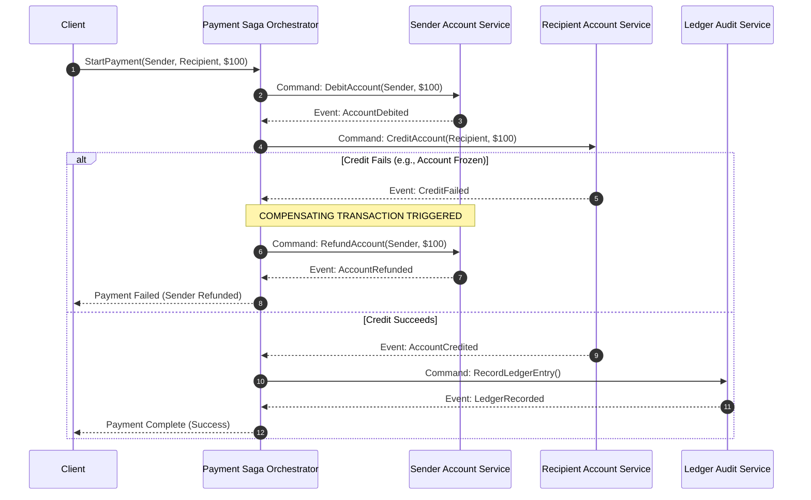

# Deep Dive: Distributed Transactions & The Saga Pattern

> **Core Focus:** Distributed System Design, Saga Choreography vs. Orchestration, Compensating Transactions, Two-Phase Commit (2PC) Failures.

---

## 1. Why Distributed Transactions are Hard

In a monolithic system like BrokeTM, atomic operations are easy because MongoDB's WiredTiger engine manages all locks and WAL records inside a single instance:

$$\text{BEGIN TRANSACTION} \longrightarrow \text{UPDATE Sender} \longrightarrow \text{UPDATE Recipient} \longrightarrow \text{COMMIT}$$

However, when decomposed into microservices:
- **Account Service** has its own database `accounts_db`.
- **Ledger Service** has its own database `ledger_db`.
- **Payment Gateway** has an external third-party API (e.g., Stripe, Razorpay).

No single database engine exists across these three systems! If the Payment Gateway captures money but the Account Service crashes, the system is out of sync.

---

## 2. Two-Phase Commit (2PC) vs. Sagas

```
Two-Phase Commit (2PC)                     The Saga Pattern
-----------------------                     ----------------
- Coordinator controls all nodes           - Sequence of local transactions
- Holds locks across the network           - No distributed locks held
- Blocks entire system on network lag      - Forward recovery or compensation
- High latency, low availability           - High availability, eventual consistency
```

---

## 3. Orchestrated Saga Implementation Architecture

An **Orchestrator** is a centralized stateful worker that sends commands to domain services and listens for execution responses.



---

## 4. Compensating Transactions: Rules of Engagement

1. **A compensating transaction cannot fail silently:** If a refund or compensation fails (e.g., database timeout), the orchestrator must retry indefinitely or route the event to a Dead Letter Queue (DLQ) for human intervention.
2. **Idempotency is Mandatory:** Because network retries can send the compensating command twice, the compensating handler must be strictly idempotent.
3. **Semantic Invariance:** A compensating transaction does not "undo" history like `git reset`. It writes a **new compensating entry** like `git revert` (e.g., Debit \$50 followed by Compensating Credit \$50).
